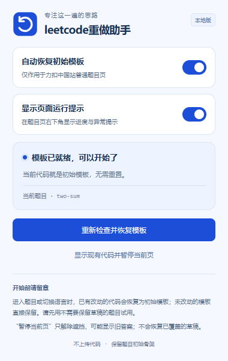

<p align="center"></p>

# leetcode重做助手

英文项目名：**leetcode-redo-helper**。当前版本：**0.3.0，本地试用版**。

打开力扣中国站的普通题目时，先遮住代码区，再与当前语言的初始模板比较：有改动才执行网站原生重置，没有改动直接显示。恢复后保留函数签名、类定义和题目给出的注释，便于重新做题。

**会覆盖已有的未提交草稿，且不提供草稿备份或恢复。请先在不需要保留草稿的题目上试用。** 历史提交记录不是删除目标，但力扣自身的自动保存可能把初始模板同步为当前草稿。

## 安装

安装包已经包含所需文件，不需要安装 Node.js、依赖或执行构建。

1. 在仓库页面点击 **Code → Download ZIP** 下载项目并完整解压，或使用 Git 克隆。将项目保存在固定的本地文件夹。
2. 在 Chrome 地址栏输入 `chrome://extensions` 并打开。
3. 开启右上角的“开发者模式”。
4. 点击左上角 **“加载未打包的扩展程序”**。有的版本称“加载已解压的扩展程序”，是同一个入口。
5. 选择包含 `manifest.json` 的项目根目录，不要选择 `dist` 或 `icons` 子目录。
6. 确认扩展名称为 **leetcode重做助手**，版本为 **0.3.0**。
7. 刷新已打开的力扣题目页。建议在 Chrome 工具栏的拼图菜单中固定本扩展。

更新已有安装：在扩展管理页点击扩展卡片的重新加载按钮，再对力扣题目页按 **Ctrl + Shift + R** 完整刷新。旧页面可能保留旧版注入的脚本和样式，仅更新文件不会替换它们；也可以关闭旧题目标签后重新打开。

## 使用

1. 打开 `https://leetcode.cn` 的普通题目，例如“两数之和”。
2. 等待代码区显示初始模板，即可输入代码和正常操作页面。
3. 刷新、站内切换题目或切换编程语言时，会再次检查模板；扩展不会为切题额外刷新整页。
4. 点击工具栏图标，在弹窗中查看当前题目及处理结果。

| 选项或按钮 | 作用 |
| --- | --- |
| 自动恢复初始模板 | 默认开启。关闭后停止自动处理并解除代码区遮挡。需要保留草稿时，先关闭此开关。 |
| 显示页面运行提示 | 默认开启。在题目页右下角显示耗时较长的处理进度和异常提示；关闭后立即隐藏，设置会保存在本机。插件弹窗仍可查看状态。 |
| 重新检查并恢复模板 | 手动重新检查当前题目；有改动才重置。 |
| 显示现有代码并暂停当前页 | 解除遮挡并临时暂停，可能看到旧答案。不会恢复已经覆盖的草稿。重新加载页面或进入另一题后会重新检查。 |

运行提示是临时状态提示，不记录或保存代码、执行日志。关闭提示不会关闭自动恢复，也不会关闭异常时解除遮挡的保护。



## 支持的浏览器与环境

| 浏览器或环境 | 当前情况 |
| --- | --- |
| Windows 桌面版 Google Chrome | 主要适配环境。已做本地浏览器回归测试和 MAIN/ISOLATED 脚本隔离测试；真实网站仍需按当前页面版本试用。 |
| Chrome 版本 | 清单要求 111 及以上，建议使用当前稳定版。没有逐个测试历史版本。 |
| macOS / Linux 桌面 Chrome | 代码未依赖 Windows 专有接口，预计兼容，尚未测试。 |
| Microsoft Edge 等 Chromium 桌面浏览器 | 预计可通过开发者模式加载，尚未测试，不作兼容保证。 |
| Firefox、Safari、手机浏览器 | 不支持。 |

仅处理 `leetcode.cn/problems/<题目>/` 和对应的 `/description/` 页面，支持题目内常见的 Monaco / CodeMirror 编辑器结构。仅在能获得并验证当前题目、当前语言的初始模板时恢复。

国际版 `leetcode.com`、竞赛、题解、历史提交详情路径不在处理范围。协作编辑状态不能可靠识别，使用协作功能前请关闭自动恢复。

## 0.3.0 的修复

- 保留网站原生确认框的进出场动画，避免覆盖弹窗的关闭流程；确认框初始化完成后才自动确认。
- 代码恢复后，继续等待确认框及网站的点击、输入限制解除，再显示“模板已就绪”。
- 新增“显示页面运行提示”开关，默认开启；关闭后也会隐藏异常恢复提示。
- 改名为 leetcode重做助手，使用原创蓝色重置箭头图标。

回归测试覆盖：未改动模板跳过重置、重置后真实点击和键盘输入、切换语言、站内切题、提示设置保存、异常解除遮挡以及 Chrome 脚本环境隔离。测试页面模拟了网站的编辑器及弹窗生命周期，不能替代真实账号下所有入口的验证，也不能保证网站更新后仍兼容。

## 遇到问题

- **升级后页面不能点击或输入：** 先确认扩展版本为 0.3.0，再完整刷新或重新打开旧题目页，清除旧版页面状态。保留草稿前请勿开启自动恢复。
- **代码区一直被遮住：** 打开插件弹窗查看原因并重试，或点击“显示现有代码并暂停当前页”。关闭右下角提示后仍可在这里操作。
- **未能验证模板：** 网站接口或编辑器结构可能变动；较长模板在无法读取完整编辑器模型时也可能校验失败。扩展不会按代码前缀猜测成功。
- **关闭扩展后旧标签页仍受影响：** 在关闭自动恢复后完整刷新该页，或关闭后重新打开。已经注入旧页面的脚本不会因修改本地文件而自动替换。
- **出现异常恢复提示：** 表示自动重置没有完成，解除遮挡后可能显示旧答案。纯脚本启动故障会触发独立恢复保护；即使全部扩展脚本停止，编辑器和自动确认框的遮挡也会在约两秒后自行失效。

## 权限与隐私

- 无扩展后端、无遥测，不由扩展上传答案、代码或草稿。
- 只申请 `storage` 权限，在本机保存两个开关；不申请 Cookie 读取权限。
- 页面脚本仅注入力扣中国站，用于识别题目、校验模板和调用网站原生重置按钮。
- 为适配站内切题，从网站原有题目数据响应中读取公开初始模板，不额外发起题目接口请求，不持久保存答案或提交记录。
- 网站自身原有的网络请求和草稿自动保存不受上述“不上传”说明涵盖。


## 本地开发

修改 `core.js`、`content.js` 或 `page-bridge.js` 后运行：

```powershell
node scripts/build.cjs
```

然后在扩展管理页重新加载并刷新题目页。`dist/` 中两个脚本各自包含私有依赖，分别用于 MAIN 和 ISOLATED 环境，不依赖跨环境的全局变量。

浏览器回归测试需要 Node.js、Playwright 和已安装的 Chrome：

```powershell
node --test --test-concurrency=1 tests/extension.test.cjs tests/worlds.test.cjs tests/popup.test.cjs tests/packaged.test.cjs
```

可通过 `LCR_PLAYWRIGHT_PATH` 指定 Playwright 模块路径，通过 `LCR_CHROME_PATH` 指定 Chrome 可执行文件。重新生成 PNG 图标使用 `node scripts/render-icons.cjs`。可选的安装包测试需要设置 `LCR_EXTENSION_CHROME_PATH` 指向支持命令行加载扩展的 Chrome for Testing；未配置时会明确跳过，不计作验证通过。
